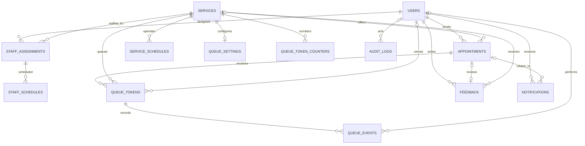

# QueueLess PostgreSQL database

This directory is the source of truth for the QueueLess PostgreSQL schema and
development seed data. Column and table names intentionally match the current
backend repositories.

## Requirements

- PostgreSQL 14 or newer
- Node.js 18 or newer for the backend migration and seed commands
- The PostgreSQL extensions `pgcrypto` and `btree_gist` (created by the first
  migration; the database role needs permission to install them)

## Create and initialize a local database

Create a database using `psql` or pgAdmin:

```sql
CREATE DATABASE queueless;
```

Set the connection values in `Backend/.env` (copy `Backend/.env.example` first),
then run the versioned migrations and optional development seed:

```powershell
cd Backend
npm run migrate
npm run seed
```

The migration runner applies files in `database/migrations/` in filename order,
records their checksums in `schema_migrations`, and serializes concurrent
migration runs with a PostgreSQL advisory lock. Never edit an applied migration;
add the next numbered file instead.
This initial migration is a fresh-schema baseline; do not point it at a database
created by the old unversioned backend migrator. Back up and recreate that local
development database, or write a dedicated conversion migration before
switching it to the versioned runner.

From the repository root, a fresh database can also be installed directly with
psql:

```powershell
psql -d queueless -f database/schema.sql
psql -d queueless -f database/seed.sql
```

`schema.sql` includes `migrations/001_initial_schema.sql` using psql's `\ir`
directive. Use `npm run migrate` to apply future migrations to a database
initialized by the versioned runner. Do not run both initialization paths
against the same database.

Seeded users are `admin@queueless.local`, `staff@queueless.local`, and
`customer@queueless.local`. Their password hashes are random and unusable; the
seed includes no passwords or credentials. Create credentials through the
application's registration or password-reset flow.

## Schema overview

### Tables and relationships

| Table | Purpose and key relationships |
|---|---|
| `users` | UUID user accounts, unique lowercase email, password hash, role, and active account status. |
| `services` | Service catalog, location, duration, and total daily-capacity default. |
| `staff_assignments` | Many-to-many staff/service relationship; named `staff_assignments` to match the backend (the conceptual `staff_services` table). |
| `staff_schedules` | Weekly availability, working hours, and optional break per staff/service assignment. |
| `service_schedules` | Weekly service hours, breaks, slot duration, and appointment capacity per slot. |
| `appointments` | Customer, service, optional assigned staff, scheduled start/end, lifecycle status, and cancellation data. Walk-ins may have no scheduled time. |
| `queue_settings` | Per-service daily token limit, service-time estimate, priority limit, and auto-call preference. |
| `queue_token_counters` | Per-service/date atomic token-number and queue-position allocators. |
| `queue_tokens` | Independent UUID token identity plus four-digit display number, date, priority, position, and live status. |
| `queue_events` | Append-only-by-convention token issuance and status-transition history, including staff actor where supplied. |
| `feedback` | One optional appointment-linked review per appointment, with user ownership and completed-appointment validation. Standalone service feedback remains supported for the existing API. |
| `notifications` | User notifications with optional appointment association, channel, type, delivery state, and attempt details. |
| `audit_logs` | Application-written administrative/queue actions, actor, resource, JSON details, and timestamp. |

`appointments.id`, `appointments.user_id` and `appointments.service_id` have
composite unique keys to support ownership- and service-aware foreign keys.
Notifications and appointment-linked feedback therefore cannot refer to
another user's appointment. `queue_tokens` likewise cannot be issued for a
service other than the appointment's service.

### Mermaid ER diagram



### Integrity, indexes, and queue rules

- UUID primary keys use `gen_random_uuid()`; timestamps are `TIMESTAMPTZ` and
  mutable tables maintain `updated_at` with triggers.
- Roles, appointment types/statuses, token states, and notification values are
  constrained enums. Ratings, hours, breaks, token numbers, capacities, and
  durations have check constraints.
- Email is unique and must already be lowercase. The backend normalizes it
  before insert and lookup; no password plaintext column or sample credential
  is stored.
- Foreign keys retain appointments/feedback history by restricting destructive
  deletes. Service-owned configuration cascades with its service; notification
  and queue-event history follows its parent. Deleting a staff account removes
  the actor reference from historic events rather than the event.
- The `btree_gist` exclusion constraint prevents overlapping active scheduled
  appointments for the same assigned staff member. It uses half-open ranges,
  so a booking can start exactly when the previous one ends. The application
  also checks service-level conflicts; use the transaction pattern below for
  booking contention.
- When a service has schedule rows, a database trigger requires scheduled
  bookings to match an available, aligned service slot, respects breaks and
  operating hours, and enforces `max_appointments_per_slot` under a
  service/slot advisory lock. Schedules use the PostgreSQL session timezone;
  configure the backend connection timezone consistently with the business
  schedule timezone. Services without schedule rows retain compatibility with
  the legacy backend's unscheduled service setup.
- A partial unique index allows at most one live token per appointment, while
  `(service_id, token_date, token_number)` prevents display-number collisions.
  The token number is limited to 1–9999 and is not the UUID identifier.
- `queue_token_counters` allocates a token number with one atomic
  `INSERT ... ON CONFLICT DO UPDATE ... RETURNING` inside the booking
  transaction. The matching position counter allocates a stable FIFO position.
  Queue display order is `is_priority DESC, position ASC`; a priority booking
  is promoted as a group without renumbering or displacing existing tokens.
- A database trigger serializes daily capacity checks by service/date, enforces
  daily/priority limits, validates token-state transitions, and writes
  `queue_events`. Allowed transitions are:

  ```text
  WAITING -> CALLED | CANCELLED
  CALLED -> SKIPPED | IN_SERVICE | COMPLETED | CANCELLED
  SKIPPED -> WAITING | CANCELLED
  IN_SERVICE -> COMPLETED | CANCELLED
  ```

- Appointment, service, user, status, queue-order, pending-notification, and
  history lookups have supporting B-tree/GiST indexes.
- Capacity per appointment slot is stored in `service_schedules` and enforced
  by the database trigger. The booking service should still check staff
  availability and provide a user-friendly conflict response; the staff
  overlap exclusion and slot trigger are the database-enforced backstops.

### Transaction patterns

Allocate each token within the same transaction as the appointment and token
insert. Do not calculate `MAX(token_number) + 1`; use the counter row:

```sql
INSERT INTO queue_token_counters (service_id, token_date, last_token_number)
VALUES ($1, $2, 1)
ON CONFLICT (service_id, token_date) DO UPDATE
SET last_token_number = queue_token_counters.last_token_number + 1
RETURNING last_token_number;
```

For a booking flow, begin a transaction, lock/check the relevant service/slot
and staff availability, insert the appointment, allocate a token counter and
position, insert the token, then commit. Allocate a stable position from the
same counter row:

```sql
UPDATE queue_token_counters
SET last_position = last_position + 1
WHERE service_id = $1 AND token_date = $2
RETURNING last_position;
```

Roll back on any conflict. The token
capacity trigger uses a service/date advisory transaction lock and the unique
indexes remain authoritative under concurrent requests. For queue serving, use
`SELECT ... FOR UPDATE SKIP LOCKED` when claiming the next token.

Useful live queue query:

```sql
SELECT id, token_number, status, is_priority, position
FROM queue_tokens
WHERE service_id = $1 AND token_date = $2
  AND status IN ('WAITING', 'CALLED', 'SKIPPED', 'IN_SERVICE')
ORDER BY is_priority DESC, position;
```

Waiting count and expected wait can be computed from `WAITING` tokens ahead of
the requested position multiplied by `queue_settings.avg_service_duration_min`.
